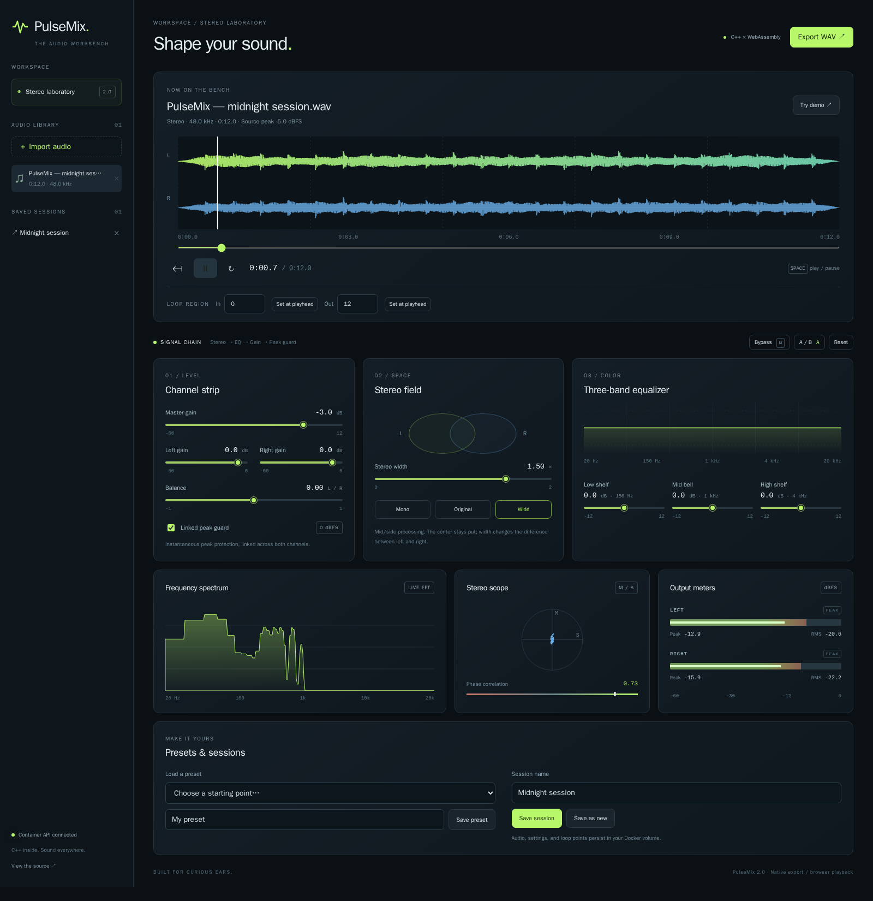

# PulseMix

**A stereo audio workbench for curious ears. C++ inside. Sound everywhere.**

PulseMix 2.0 evolves the original Linux C++/GTK experiment into a containerized browser app. A shared C++ engine powers real-time WebAssembly playback and native audio export. Docker provides the build tools, API, web server, and persistent storage; your browser plays the audio through your Mac's speakers.



## Features

- Drag-and-drop WAV/FLAC import, a persistent audio library, and a generated stereo demo.
- Play/pause, seek, editable loop regions, and keyboard shortcuts.
- Separate stereo waveforms, a live spectrum, peak/RMS meters, a mid/side vectorscope, and phase correlation.
- Master/channel gain, balance, real mid/side stereo width, and three-band EQ with a response curve.
- Smoothed controls, linked peak protection, bypass, and two editable A/B snapshots.
- Built-in/custom presets and saved sessions with settings and loop points.
- Native C++ export to stereo **32-bit float WAV** at the source sample rate. Export renders the entire track with the current settings; loops are playback-only.
- Multi-stage container builds, hot-reload development, engine/API/browser tests, and CI.

Input limits: mono/stereo WAV or FLAC, 100 MiB upload, five minutes, 12 million frames, and 8–192 kHz. All limits apply together. Mono is duplicated to stereo. The browser holds decoded audio in memory, so this is a short-track workbench.

## Quick start

Install Docker Desktop, or use Colima on macOS. For Homebrew/Colima:

```bash
brew install colima docker docker-compose docker-buildx
colima start
```

If `docker compose` or `docker buildx` is unavailable, merge `cliPluginsExtraDirs` into your existing `~/.docker/config.json` (retain its other keys):

```json
{
  "cliPluginsExtraDirs": ["/opt/homebrew/lib/docker/cli-plugins"]
}
```

On Intel Homebrew use `/usr/local/lib/docker/cli-plugins`. Docker Desktop already includes these plugins.

From the repository root:

```bash
docker compose up --build -d --wait
```

Open **http://localhost:8080**, click **Try demo**, then **Play**. No host Node, Python, CMake, GTK, or audio drivers are needed. The initial build downloads a sizeable compiler image; subsequent builds reuse cached layers.

On Apple Silicon, the pinned Emscripten compiler stage uses AMD64 emulation. Its WASM artifact is platform-independent; API, Node, and nginx run natively on ARM64. Colima enables the emulation during startup.

```bash
docker compose logs -f       # Watch both services
docker compose down          # Stop; retain audio and sessions
```

Set a different host port with `PULSEMIX_PORT=8081 docker compose up -d`. Use localhost or HTTPS: AudioWorklet is unavailable on ordinary HTTP LAN addresses. Playback begins only after you press Play.

## Development

```bash
docker compose down
docker compose -f compose.yaml -f compose.dev.yaml up --build
```

Open **http://localhost:5173**. React/TypeScript source and Python API edits reload automatically. The development API docs are at **http://localhost:8000/docs**. Rebuild after C++/WASM, dependencies, worklet, or configuration changes. The same named volume keeps your sessions between development and release modes. Compose 2.24.4+ is required for the development overlay's `!override` tag.

### Shortcuts

| Key | Action |
| --- | --- |
| Space | Play/pause |
| Left / Right | Seek five seconds |
| B | Toggle bypass |
| L | Toggle loop |

Shortcuts are inactive while editing fields or focusing buttons; native keyboard control remains available for all sliders and buttons.

## Tests

Run native DSP and API tests in disposable containers:

```bash
docker compose --profile test run --build --rm engine-test
docker compose --profile test run --build --rm api-test
```

Run browser tests against a separate project/volume, leaving your own library alone:

```bash
PULSEMIX_PORT=8081 docker compose -p pulsemix-test up -d --build --wait
PULSEMIX_PORT=8081 docker compose -p pulsemix-test --profile test run --build --rm web-test
docker compose -p pulsemix-test down -v --remove-orphans
```

The final command removes **test** storage. `docker compose down -v` on your normal project would remove your actual audio and sessions.

Browser checks cover actual AudioWorklet playback, loops, A/B, session restoration, export, invalid input, a mobile viewport, and native/WASM sample parity at 48 kHz. Browser playback is resampled to the audio device's rate; export preserves the source rate, so different-rate preview/export are not bit-identical. Automated browser coverage is Chromium; check Safari on your Mac before a release.

## Native CLI

Optional macOS build:

```bash
brew install cmake pkgconf libsndfile
cmake -S . -B build -DCMAKE_BUILD_TYPE=Release
cmake --build build
ctest --test-dir build --output-on-failure
./build/pulsemix analyze track.wav
./build/pulsemix render track.wav processed.wav
```

Explicit processing arguments, in order: master dB, left dB, right dB, balance, width, low dB, mid dB, high dB, bypass, peak guard:

```bash
./build/pulsemix render track.wav processed.wav -3 0 0 0 1.5 2 0 -1 0 1
```

For DSP-only development without libsndfile, configure with `-DPULSEMIX_BUILD_CLI=OFF`.

## Project map

```text
engine/                  Shared C++ DSP, native CLI, WASM bridge, tests
api/                     FastAPI, SQLite persistence, API integration tests
web/                     React/TypeScript, AudioWorklet, visualizations, Playwright
docker/                  Multi-stage builds and nginx reverse proxy
compose.yaml             Release-like local app and optional test services
compose.dev.yaml         Hot-reload development overlay
docs/                    Architecture, DSP explanation, Docker learning exercises
.github/workflows/       Tests and tagged ARM64/AMD64 image publishing
pulsemix.cpp             Original GTK prototype (optional legacy CMake target)
```

Start learning with [Docker exercises](docs/docker-learning.md), then explore the [architecture](docs/architecture.md) and [audio engine](docs/audio-engine.md). See the [contribution guide](CONTRIBUTING.md) for verification and release steps.

### Original desktop experiment

`pulsemix.cpp` is retained as the historical prototype. To build it on Debian/Ubuntu:

```bash
sudo apt install build-essential cmake pkg-config libgtk-3-dev portaudio19-dev libsndfile1-dev
cmake -S . -B build -DPULSEMIX_BUILD_LEGACY=ON
cmake --build build --target pulsemix-legacy
./build/pulsemix-legacy
```

The legacy target retains its original behavior and threading limitations. The workbench uses the new engine instead.

## License

MIT. See [LICENSE](LICENSE).
